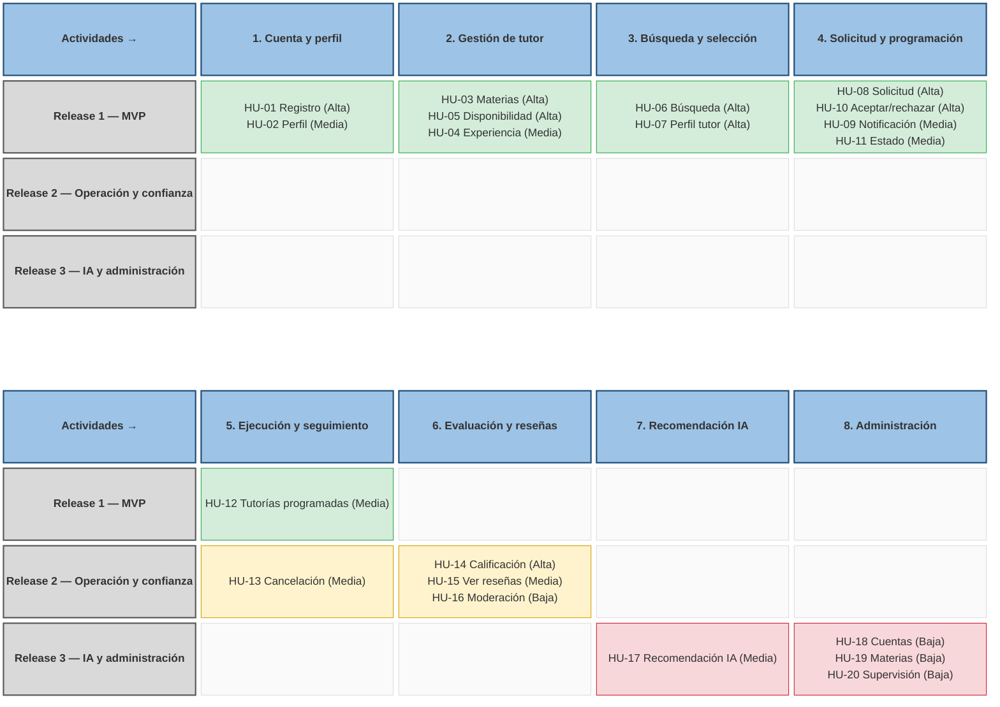

# Workshop 1 — Ingeniería de Software II

**Universidad Nacional de Colombia — Semestre 2026-II**
**Docente:** Eng. Liliana Marcela Olarte, M.Sc.
**Proyecto:** Plataforma web y móvil de tutorías académicas
**Fecha límite de entrega:** 30 de septiembre de 2026, 23:00

## Integrantes

- Camilo Alejandro Lagos Malaver — Desarrollador Backend
- Oscar Javier Saavedra Montero — Desarrollador Frontend
- Angel Palacio Suarez — Diseñador UX/UI
- Laura Alejandra Cadavid Mendoza — Desarrolladora Frontend / Mobile
- Brahian Camilo Gomez Carvajal — Gestor de proyecto / QA

## Descripción del proyecto

Plataforma web y móvil que conecta estudiantes que requieren apoyo académico con tutores especializados en determinadas materias o temas. Permite buscar tutores, solicitar y gestionar tutorías, calificar el servicio recibido y recibir recomendaciones de tutores mediante un servicio de inteligencia artificial (OpenRouter).

## Contenido de esta entrega

Este Workshop 1 corresponde a la fase de análisis del proyecto de curso y contiene:

1. Descripción general del sistema
2. Problema y objetivos
3. Alcance (incluido y excluido)
4. Actores del sistema
5. Requisitos funcionales (RF-01 a RF-29)
6. Requisitos no funcionales (RNF-01 a RNF-12)
7. Historias de usuario (HU-01 a HU-20) con criterios de aceptación Given/When/Then
8. Mapa de historias de usuario (User Story Mapping), representado como diagrama elaborado con Mermaid (Figura 1)
9. Priorización y releases (Release 1: MVP, Release 2: Operación y confianza, Release 3: Inteligencia y administración avanzada)
10. Trazabilidad de requisitos funcionales → historias de usuario → release
11. Stack tecnológico
12. Referencias

Todo el contenido detallado se encuentra en el archivo `Workshop-1.pdf` incluido en esta carpeta.

## Mapa de historias de usuario

Backbone horizontal con las 8 actividades del usuario; en vertical, las historias de cada actividad ordenadas por prioridad y separadas por release (verde: Release 1 — MVP, amarillo: Release 2, rojo: Release 3). El código fuente del diagrama está en `mapa-historias-usuario.mmd`.



## Estructura sugerida en el repositorio

```
Workshop-1/
├── README.md
├── Workshop-1.pdf
└── mapa-historias-usuario.mmd
```

## Stack tecnológico

- Frontend web: React
- Aplicación móvil: Expo
- Backend: Django
- Base de datos: MySQL
- Inteligencia artificial: OpenRouter

## Documento fuente

El documento editable (Google Docs) del cual se exporta `Workshop-1.pdf` se encuentra en:
https://docs.google.com/document/d/1RLOBo4HdvkvIJJ2SXF_64cJODejhgisVgqAobpvDnnc/edit
